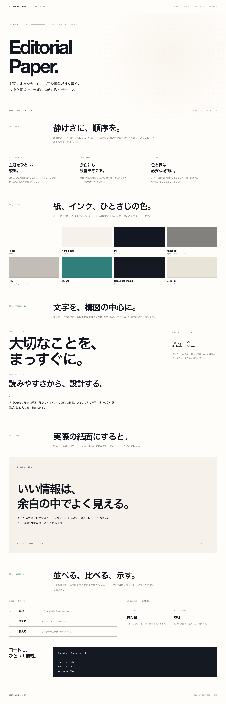

# design-md

個人のデザインガイド集です。各ディレクトリの `DESIGN.md` は、媒体や実装技術を限定せず、そのデザインの見た目と判断基準を記述します。

## Editorial Paper

白い紙面、濃いインク、余白、細い罫線を中心にした編集的なデザインです。

- [デザインガイド](./editorial-paper/DESIGN.md)
- [ブラウザで見るプレビュー](./editorial-paper/preview.html)
- [プレビュー画像](./editorial-paper/preview-screenshot.png)

プレビューは外部の画像やフォントに依存しない単一の HTML ファイルです。
